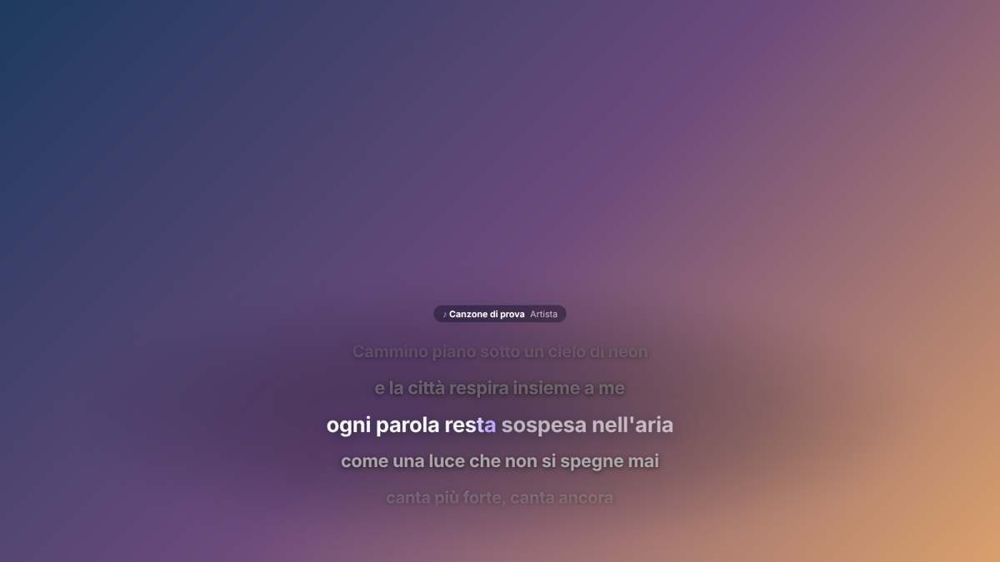

# 🎵 Lyrics Overlay

**Lyrics of the song you're listening to, right on your desktop.**

Lyrics Overlay detects what's playing on your PC (YouTube in your browser, Spotify, VLC, or any app that uses the Windows media controls), finds the synced lyrics and shows them on top of every window over a fully transparent background. Only the words are visible, and the current line fills up in time with the music, karaoke-style. Clicks pass straight through the text, so you can keep using your computer as usual.



## ✨ Features

- **Automatic song detection** through the Windows media controls (GSMTC): works with Chrome, Edge, Firefox, Spotify, VLC and more, with no extensions or logins.
- **Synced lyrics** from [LRCLIB](https://lrclib.net), free and with no API key. When only plain lyrics exist, they scroll across the length of the track.
- **Karaoke effect** on the current line, smooth scrolling and fades between songs.
- **Transparent, click-through overlay** that always stays on top.
- **Smart YouTube title cleanup**: removes `(Official Video)`, `[4K]`, `VEVO` and `- Topic`, and splits "Artist - Title".
- **Local lyrics cache**, so songs you've already played show up instantly.
- **System tray icon** with settings for position, text size and sync correction.
- **Global keyboard shortcuts.**

## 📦 Requirements

- Windows 10 or 11
- [Node.js](https://nodejs.org) **v24 LTS** (installing Electron may fail on v26)

## 🚀 Installation

```bash
git clone https://github.com/<your-username>/lyrics-overlay.git
cd lyrics-overlay
npm install
npm start
```

A purple icon appears in the system tray. Play a song and the lyrics show up within a few seconds.

## ⌨️ Shortcuts

| Keys | Action |
|---|---|
| `Ctrl + Alt + L` | Show / hide lyrics |
| `Ctrl + Alt + P` | Change position (bottom → center → top) |
| `Ctrl + Alt + PgUp` | Lyrics are late → shift 0.5 s earlier |
| `Ctrl + Alt + PgDn` | Lyrics are early → shift 0.5 s later |
| `Ctrl + Alt + +` / `-` (numpad) | Bigger / smaller text |

The same options are in the tray icon menu (right-click), along with *Cerca di nuovo il testo* (search lyrics again) and *Esci* (quit). The app interface is currently in Italian.

## 🔁 Start with Windows

1. Create `avvia.bat` in the project folder:
   ```bat
   cd /d "%~dp0"
   npm start
   ```
2. To launch it without a terminal window, create `avvia-nascosto.vbs` (use your own folder path):
   ```vb
   CreateObject("WScript.Shell").Run """C:\path\to\lyrics-overlay\avvia.bat""", 0, False
   ```
3. Press `Win + R`, type `shell:startup` and put a shortcut to `avvia-nascosto.vbs` in that folder.

## 🛠️ How it works

```
native/nowplaying.ps1     reads title, artist, duration and position from Windows (GSMTC)
        │  one JSON line every 400 ms
src/main/nowPlaying.ts    runs the script and turns its output into events
src/main/titleCleaner.ts  cleans up track titles and artist names
src/main/lyrics.ts        searches LRCLIB, picks the best match (duration, title, artist), caches results
src/main/main.ts          transparent window, tray icon, shortcuts, settings
src/renderer/             visuals (HTML + CSS) and smooth syncing with the music
```

**Built with:** Electron · TypeScript · Windows PowerShell (WinRT) · LRCLIB API

## 🎨 Customization

All styling lives in [`src/renderer/styles.css`](src/renderer/styles.css):

- `--accent`: color of the karaoke effect
- `--fs`: text size
- `--visible-lines`: number of visible lines
- `#glow`: soft dark halo behind the text, helpful on light backgrounds
- `font-family`: the typeface

## ❓ Troubleshooting

- **Nothing happens with YouTube:** press a volume key and check that the media flyout appears. On Firefox, set `media.hardwaremediakeys.enabled = true` in `about:config`.
- **Wrong lyrics:** tray icon → *Cerca di nuovo il testo*. The `[track] ...` line in the terminal shows what the app detected.
- **Lyrics out of sync:** use `Ctrl + Alt + PgUp/PgDn`.
- **`Electron failed to install correctly`:** use Node.js v24 LTS, then delete `node_modules` and `package-lock.json` and run `npm install` again.
- **Black background instead of transparent:** update your graphics drivers.

## 🗺️ Roadmap

- [ ] Linux support (MPRIS / `playerctl`)
- [ ] Colors taken from the album artwork
- [ ] Word-by-word lyrics (enhanced LRC)
- [ ] Fallback lyrics sources when LRCLIB has no match
- [ ] `.exe` installer with built-in auto-start

## 🧪 Tests

```bash
npm test
```

Checks the title cleanup and the LRC parser without opening the window.

## 🙏 Credits

- Lyrics provided by [LRCLIB](https://lrclib.net), an open, community-driven database.

## 📄 License

MIT. Song lyrics belong to their respective authors: this app only displays them and does not redistribute them.
